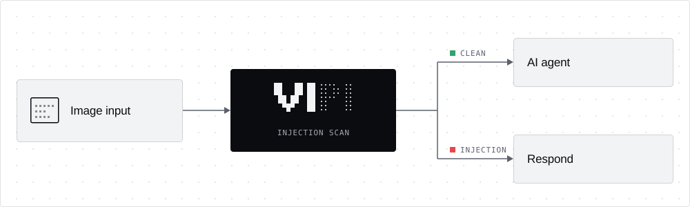

<h1 align="center">
  VIPI — Visual Prompt Injection Scanner for Images
</h1>

<p align="center">
  
</p>

<p align="center">
  <b>Scan images for prompt injections before an AI agent reads them.</b><br>
  A Python CLI and GitHub Action. Runs fully local or with hosted providers.
</p>

<p align="center">
  <a href="https://github.com/EnXan/VIPI/blob/main/pyproject.toml"></a>
  <a href="https://pypi.org/project/vipi-scanner/"></a>
  <a href="https://github.com/EnXan/VIPI/blob/main/docs/cli.md#platform-validation-status"></a>
</p>

Images can carry instructions that people overlook but AI models read. VIPI
finds the text in an image, including text that standard OCR misses, and checks
it for prompt injections. It scans single images, folders and committed image
changes.

- **CI/CD and AI code review:** scan pull-request images before AI triage tools
  or coding assistants read them.
- **Image ingestion:** scan uploaded or collected images before they enter an
  AI pipeline.
- **Agents with image input:** check screenshots before an agent decides or acts
  on them.

<p align="center">
  
</p>

## Quick start

Requires Python 3.12 and [uv](https://docs.astral.sh/uv/getting-started/installation/).

**Local:** images never leave your machine.

```bash
uv tool install --python 3.12 'vipi-scanner[ocr,detector-local]'
vipi setup --ocr-mode balanced
vipi scan image.png --ocr-mode balanced --output report.json
```

**Cloud:** hosted OCR and decisions. Set `GOOGLE_CLOUD_API_KEY` and
`OPENAI_API_KEY` in the environment or an ignored `.env`
([example](https://github.com/EnXan/VIPI/blob/main/.env.example)).

```bash
uv tool install --python 3.12 'vipi-scanner[ocr]'
vipi setup --modus cloud
vipi scan image.png --modus cloud --output report.json
```

Run `setup` with the same options you scan with. A bare `vipi setup` also
downloads the large `quality` model. If `vipi` is not on `PATH`, run
`uv tool update-shell` and restart the terminal.

## Models at a glance

Every scan runs up to three steps; step 2 runs only when the OCR result is
uncertain. The mode decides who provides the models.

| Step | Local `quality` (default) | Local `balanced` | Local `speed` | Cloud |
| :-- | :-- | :-- | :-- | :-- |
| 1 · Read text |  PP-OCRv6 Medium<br><sub>or Small · Tiny</sub> |  PP-OCRv6 Small<br><sub>or Medium · Tiny</sub> |  PP-OCRv6 Tiny<br><sub>or Medium · Small</sub> |  Cloud Vision<br><sub>or  OpenAI ·  Mistral</sub> |
| 2 · Verify OCR visually |  Clef 27B<br><sub>or  d1 3B ·  Clef-Flash 9B</sub> |  d1 3B<br><sub>or  Clef 27B · Clef-Flash 9B</sub> |  d1 3B<br><sub>or  Clef 27B · Clef-Flash 9B</sub> |  Decisions API<br><sub>or  TypeSafe Jev</sub> |
| 3 · Detect injections |  Clef 27B<br><sub>or  d1 3B ·  Clef-Flash 9B ·  Prompt Guard 2</sub> |  d1 3B<br><sub>or  Clef 27B · Clef-Flash 9B ·  Prompt Guard 2</sub> |  d1 3B<br><sub>or  Clef 27B · Clef-Flash 9B ·  Prompt Guard 2</sub> |  Decisions API<br><sub>or  TypeSafe Jev</sub> |
| Memory, Apple Silicon or GPU&nbsp;¹ | ~96 GB unified memory<br><sub>or 80 GB VRAM</sub> | ~16 GB unified memory<br><sub>or 16 GB VRAM</sub> | 16 GB unified memory (measured)<br><sub>or 16 GB VRAM</sub> | ~8 GB RAM<br><sub>no GPU needed</sub> |
| Memory, CPU only&nbsp;¹ | ~128 GB RAM | ~24 GB RAM | ~24 GB RAM | ~8 GB RAM |

¹ Estimates with the defaults; only `speed` on an Apple M2 with 16 GB was measured.
Decision models load unquantized: 16-bit on Apple Silicon and CUDA, 32-bit on CPU.
Clef 27B alone needs ~55 GB in 16-bit and ~109 GB in 32-bit, which is why `quality`
needs far more memory than a quantized 27B model in a local chat app. Clef-Flash 9B
needs ~19 GB in 16-bit. Disk space,
model IDs and pinned revisions are in [Models and hardware](https://github.com/EnXan/VIPI/blob/main/docs/models.md).

## Usage

```bash
vipi scan label.png screenshot.jpg
vipi scan ./images --verbose --output report.json
vipi scan ./images --exclude 'generated/' --exclude '*.webp'
vipi scan . --diff origin/main --output report.json
vipi scan image.png --modus cloud --detector openai --threshold 90
```

| Format | Extensions | Notes |
| :-- | :-- | :-- |
| PNG | `.png` | Static images only; animated PNGs are rejected |
| JPEG | `.jpg`, `.jpeg` | EXIF orientation is applied |
| WebP | `.webp` | Static images only; animated WebPs are rejected |

Extensions are matched case-insensitively. Local inputs are limited to 40
megapixels; hosted inputs follow provider limits. Other file types in scanned
folders or diffs are skipped and listed in the report.

A score at or above the threshold (default 80/100) is a finding. Scores are not
calibrated probabilities, and a score below the threshold does not prove an
image is safe. Cloud scans can make additional billable requests.

| Exit code | Result |
| :-- | :-- |
|  `0` | Scan complete, no findings |
|  `1` | Injection found, every image completed |
|  `2` | Error or incomplete scan; wins over findings |

Every option, credential and report field is in the
[CLI reference](https://github.com/EnXan/VIPI/blob/main/docs/cli.md).

## GitHub Actions

Scan the images a pull request adds or changes. This example uses the local
`balanced` profile with Meta Prompt Guard as the injection detector:

```yaml
name: VIPI image scan
on:
  pull_request:
    branches: [main]
permissions:
  contents: read
jobs:
  scan:
    runs-on: ubuntu-latest
    steps:
      - uses: actions/checkout@3d3c42e5aac5ba805825da76410c181273ba90b1 # v7.0.1
        with:
          fetch-depth: 0
      - uses: EnXan/VIPI@v0.7.0
        with:
          modus: local
          ocr-mode: balanced
          detector: prompt-guard
        env:
          HF_TOKEN: ${{ secrets.HF_TOKEN }}
      - uses: actions/upload-artifact@043fb46d1a93c77aae656e7c1c64a875d1fc6a0a # v7.0.1
        if: always()
        with:
          name: vipi-report
          path: vipi-report.json
```

The runner needs enough memory for the chosen models, and Prompt Guard requires
accepted model terms on Hugging Face. Fork PRs normally get no secrets. For
hosted models, set `modus: cloud` and the provider keys; see
[Action inputs](https://github.com/EnXan/VIPI/blob/main/docs/cli.md#github-action).

## Documentation

- [CLI reference and platform validation](https://github.com/EnXan/VIPI/blob/main/docs/cli.md)
- [Models and hardware](https://github.com/EnXan/VIPI/blob/main/docs/models.md)
- [OCR recovery and measured limits](https://github.com/EnXan/VIPI/blob/main/docs/ocr-recovery.md)
- [Architecture](https://github.com/EnXan/VIPI/blob/main/docs/architecture.md) and [development](https://github.com/EnXan/VIPI/blob/main/docs/development.md)
- [Research CLI](https://github.com/EnXan/VIPI/blob/main/docs/research-cli.md), [workbench](https://github.com/EnXan/VIPI/blob/main/research/workbench/README.md) and [datasets](https://github.com/EnXan/VIPI/blob/main/research/README.md)
- [Decision records](https://github.com/EnXan/VIPI/blob/main/adr-code/README.md)

## License

VIPI's code, documentation and assets use the
[Apache License 2.0](https://github.com/EnXan/VIPI/blob/main/LICENSE). Models,
dependencies, datasets and provider marks keep their own terms.
