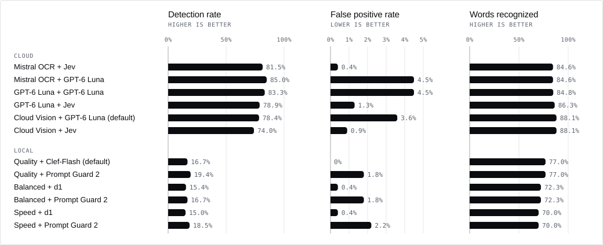

<h1 align="center">
  VIPI — Visual Prompt Injection Scanner for Images
</h1>

<p align="center">
  
</p>

<p align="center">
  <b>Scan images for prompt injections before an AI agent reads them.</b><br>
  A Python CLI and a <a href="https://github.com/EnXan/vipi-action">GitHub Action</a>. Runs fully local or with hosted providers.
</p>

<p align="center">
  <a href="https://github.com/EnXan/VIPI/blob/main/pyproject.toml"></a>
  <a href="https://pypi.org/project/vipi-scanner/"></a>
  <a href="https://github.com/EnXan/VIPI/blob/main/docs/cli.md#platform-validation-status"></a>
</p>

Images can carry harmful instructions that people overlook but AI models read. VIPI
finds the text in an image, including text that standard OCR misses, and checks
it for prompt injections. It scans single images, folders and committed image
changes.

- **CI/CD and AI code review:** scan pull-request images before AI triage tools
  or coding assistants read them.
- **Image ingestion:** scan uploaded or collected images before they enter an
  AI pipeline.
- **Agents with image input:** check screenshots before an agent decides or acts
  on them.

## Quick start

Requires Python 3.12 and [uv](https://docs.astral.sh/uv/getting-started/installation/).

### Local
**Images never leave your machine**. Be aware that local mode downloads several gigabytes of models during `vipi setup` and has hardware requirements as stated in [Models and hardware](https://github.com/EnXan/VIPI/blob/main/docs/models.md).

```bash
uv tool install --python 3.12 'vipi-scanner[ocr,detector-local]'
vipi setup --ocr-mode balanced
vipi scan image.png --ocr-mode balanced --output report.json
```

Choose a profile; use the same one for `setup` and `scan`:

```text
vipi setup --ocr-mode {quality|balanced|speed}
vipi scan image.png --ocr-mode {quality|balanced|speed} --output report.json
```

### Cloud
Hosted OCR pipeline and injection detection. The defaults are Google OCR and OpenAI's decision API for injection detection.
Set only the API keys for the providers you use
([keys](https://github.com/EnXan/VIPI/blob/main/docs/cli.md#credentials-and-local-models),
[`.env` example](https://github.com/EnXan/VIPI/blob/main/.env.example)).

```bash
uv tool install --python 3.12 'vipi-scanner[ocr]'
vipi setup --modus cloud
vipi scan image.png --modus cloud --output report.json
```

Choose providers per scan:

```text
vipi scan image.png --modus cloud \
  --ocr-provider {google|openai|mistral} \
  --decision-provider {openai|jev} \
  --output report.json
```

If `vipi` is not on `PATH`, run `uv tool update-shell` and restart the terminal.

## How it works (Overview)

Every scan runs up to three steps. OCR reads the text in the image. If the
result is unclear, a visual model compares it with the image; when text is
missing, VIPI reads the image again rotated, with more contrast or upscaled. A
detector then checks the final text for prompt injections and reports a finding
at a score of 80 or more. The mode decides who provides the models: local runs
them on your machine, cloud calls the providers' APIs.

<p align="center">
  
</p>

<details>
<summary>Models and memory per mode</summary>

| Step | Local `quality` (default) | Local `balanced` | Local `speed` | Cloud |
| :-- | :-- | :-- | :-- | :-- |
| 1 · Read text |  PP-OCRv6 Medium<br><sub>or Small · Tiny</sub> |  PP-OCRv6 Small<br><sub>or Medium · Tiny</sub> |  PP-OCRv6 Tiny<br><sub>or Medium · Small</sub> |  Cloud Vision<br><sub>or  OpenAI ·  Mistral</sub> |
| 2 · Verify OCR visually |  Clef-Flash 9B<br><sub>or  d1 3B</sub> |  d1 3B<br><sub>or  Clef-Flash 9B</sub> |  d1 3B<br><sub>or  Clef-Flash 9B</sub> |  Decisions API<br><sub>or  TypeSafe Jev</sub> |
| 3 · Detect injections |  Clef-Flash 9B<br><sub>or  d1 3B ·  Prompt Guard 2</sub> |  d1 3B<br><sub>or  Clef-Flash 9B ·  Prompt Guard 2</sub> |  d1 3B<br><sub>or  Clef-Flash 9B ·  Prompt Guard 2</sub> |  Decisions API<br><sub>or  TypeSafe Jev</sub> |
| Memory, Apple Silicon or GPU&nbsp;¹ | 48 GB unified memory (measured)<br><sub>or 24 GB VRAM</sub> | ~16 GB unified memory<br><sub>or 16 GB VRAM</sub> | 16 GB unified memory (measured)<br><sub>or 16 GB VRAM</sub> | ~8 GB RAM<br><sub>no GPU needed</sub> |
| Memory, CPU only&nbsp;¹ | ~48 GB RAM | ~24 GB RAM | ~24 GB RAM | ~8 GB RAM |

¹ Estimates with the defaults; measured were `speed` on an Apple M2 with 16 GB and
`quality` on an Apple M4 Pro with 48 GB.
Decision models load unquantized: 16-bit on Apple Silicon and CUDA, 32-bit on CPU.
Clef-Flash 9B needs ~19 GB in 16-bit and ~38 GB in 32-bit. Disk space,
model IDs and pinned revisions are in [Models and hardware](https://github.com/EnXan/VIPI/blob/main/docs/models.md).

</details>

## Performance

How well VIPI currently reads text in images and detects prompt injections,
measured on the publicly available
[VIPI evaluation dataset](https://huggingface.co/datasets/EnXan/VIPI-evaluation).
New images are welcome: they help us test VIPI more thoroughly, and other
projects can use the dataset to evaluate their own OCR or injection detection.
See [contributing to the dataset](https://github.com/EnXan/VIPI/blob/main/CONTRIBUTING.md#evaluation-dataset).

<p align="center">
  
</p>

<details>
<summary>Exact values and models</summary>

| Cloud OCR | Detector | Detection rate | False positive rate | Words recognized |
| :-- | :-- | --: | --: | --: |
| Mistral OCR 4.1 | TypeSafe Jev 1.14 | 81.5% | **0.4%** | 84.6% |
| Mistral OCR 4.1 | OpenAI GPT-6 Luna (Decisions API) | **85.0%** | 4.5% | 84.6% |
| OpenAI GPT-6 Luna | OpenAI GPT-6 Luna (Decisions API) | 83.3% | 4.5% | 84.8% |
| OpenAI GPT-6 Luna | TypeSafe Jev 1.14 | 78.9% | 1.3% | 86.3% |
| Google Cloud Vision | OpenAI GPT-6 Luna (Decisions API, default) | 78.4% | 3.6% | **88.1%** |
| Google Cloud Vision | TypeSafe Jev 1.14 | 74.0% | 0.9% | **88.1%** |

| Local OCR | Detector | Detection rate | False positive rate | Words recognized |
| :-- | :-- | --: | --: | --: |
| PP-OCRv6 Medium (`quality`) | Clef-Flash 9B (default) | 16.7% | **0%** | **77.0%** |
| PP-OCRv6 Medium (`quality`) | Prompt Guard 2 86M | **19.4%** | 1.8% | **77.0%** |
| PP-OCRv6 Small (`balanced`) | d1 3B | 15.4% | 0.4% | 72.3% |
| PP-OCRv6 Small (`balanced`) | Prompt Guard 2 86M | 16.7% | 1.8% | 72.3% |
| PP-OCRv6 Tiny (`speed`) | d1 3B | 15.0% | 0.4% | 70.0% |
| PP-OCRv6 Tiny (`speed`) | Prompt Guard 2 86M | 18.5% | 2.2% | 70.0% |

</details>

## Usage

```bash
vipi scan label.png screenshot.jpg                       # single images
vipi scan ./images --verbose --output report.json        # folder, print OCR text, save JSON report
vipi scan ./images --exclude 'generated/' --exclude '*.webp'
vipi scan . --diff origin/main --output report.json      # only images changed since origin/main
vipi scan image.png --threshold 90                       # stricter finding threshold

# other detector: prepare it first, scans never download models
vipi setup --ocr-mode balanced --detector prompt-guard
vipi scan ./images --ocr-mode balanced --detector prompt-guard
vipi scan image.png --modus cloud --detector jev
```

For permanent exclusions, copy
[`.vipiignore.example`](https://github.com/EnXan/VIPI/blob/main/.vipiignore.example)
to `.vipiignore`.

| Format | Extensions | Notes |
| :-- | :-- | :-- |
| PNG | `.png` | Static images only; animated PNGs are rejected |
| JPEG | `.jpg`, `.jpeg` | EXIF orientation is applied |
| WebP | `.webp` | Static images only; animated WebPs are rejected |

A score at or above the threshold (default 80) is a finding. Size limits,
skipped files and what a score does not tell you are in
[Limitations](https://github.com/EnXan/VIPI/blob/main/docs/cli.md#limitations).

Every option, credential and report field is in the
[CLI reference](https://github.com/EnXan/VIPI/blob/main/docs/cli.md).

## GitHub Actions

The Action lives in [EnXan/vipi-action](https://github.com/EnXan/vipi-action)
and is listed on the [GitHub Marketplace](https://github.com/marketplace/actions/vipi-visual-prompt-injection-scan).
It scans the images a pull request adds or changes. Its default cloud mode uses
Google Cloud Vision for OCR and OpenAI for decisions:

```yaml
name: VIPI image scan
on:
  pull_request:
    branches: [main]
permissions:
  contents: read
jobs:
  scan:
    runs-on: ubuntu-latest
    steps:
      - uses: actions/checkout@v7
        with:
          fetch-depth: 0
      - uses: EnXan/vipi-action@v1
        env:
          GOOGLE_CLOUD_API_KEY: ${{ secrets.GOOGLE_CLOUD_API_KEY }}
          OPENAI_API_KEY: ${{ secrets.OPENAI_API_KEY }}
      - uses: actions/upload-artifact@v7
        if: always()
        with:
          name: vipi-report
          path: vipi-report.json
```

> **Note:** Local mode is not recommended on standard GitHub-hosted runners.
> They have no GPU and too little memory for the local models, so scans can
> take very long or fail. In our test on a standard runner, `balanced` took
> about 9 minutes for two images, plus 2 minutes of setup; `quality` could not
> even load its model. Self-hosted or larger runners with enough memory,
> ideally with a GPU, can run local mode, but it remains slower than cloud mode.

Other providers are set with `ocr-provider` and `decision-provider` and need
their own keys; see the
[Action configuration](https://github.com/EnXan/vipi-action#configuration).
Fork PRs normally get no secrets, so their scans cannot reach the providers.

## Workbench

The workbench is a visual companion to the CLI that makes it easier to inspect
scan results, compare evaluations and edit the dataset in your browser. It runs
on your machine and uses the same scan pipeline as `vipi scan`, with local or
cloud settings.

- **Scan an image:** choose, drop or paste an image. Inspect the verdict,
  injection probability, recognized text and individual OCR passes, along with
  scan time and API cost.
- **Evaluate:** run a configuration on the dataset's development split,
  compare OCR and detection results with a saved baseline, and download reports.
  Runs can be stopped and resumed.
- **Dataset:** add images, edit labels and reference text, and submit your
  changes as a pull request on Hugging Face.

The workbench is included in the repository, not the PyPI package. With
Python 3.12 and uv installed, run:

```bash
git clone https://github.com/EnXan/VIPI.git
cd VIPI
uv sync --extra ocr --extra detector-local --extra research --extra test
uv run vipi setup
uv run python -m research.workbench serve
```

Open [localhost:8000](http://127.0.0.1:8000). The default is local **Quality**;
`vipi setup` downloads its models, so check the
[hardware requirements](https://github.com/EnXan/VIPI/blob/main/docs/models.md)
first. For cloud scans, skip local model setup, configure the
[provider API keys](https://github.com/EnXan/VIPI/blob/main/docs/cli.md#credentials-and-local-models)
and choose **Cloud** under **Change settings**. Cloud scans incur API charges.

For **Evaluate** and **Dataset**, download the evaluation dataset from the
repository root before starting the workbench:

```bash
uv run python -m research.download
```

See the [workbench guide](https://github.com/EnXan/VIPI/blob/main/research/workbench/README.md)
for settings, baseline comparisons and dataset contributions.

## Documentation

- [CLI reference and platform validation](https://github.com/EnXan/VIPI/blob/main/docs/cli.md)
- [Models and hardware](https://github.com/EnXan/VIPI/blob/main/docs/models.md)
- [OCR recovery and measured limits](https://github.com/EnXan/VIPI/blob/main/docs/ocr-recovery.md)
- [Architecture](https://github.com/EnXan/VIPI/blob/main/docs/architecture.md) and [development](https://github.com/EnXan/VIPI/blob/main/docs/development.md)
- [Research CLI](https://github.com/EnXan/VIPI/blob/main/docs/research-cli.md), [workbench](https://github.com/EnXan/VIPI/blob/main/research/workbench/README.md) and [datasets](https://github.com/EnXan/VIPI/blob/main/research/README.md)
- [Decision records](https://github.com/EnXan/VIPI/blob/main/adr-code/README.md)

## License

VIPI's code, documentation and assets use the
[Apache License 2.0](https://github.com/EnXan/VIPI/blob/main/LICENSE). Models,
dependencies, datasets and provider marks keep their own terms.
