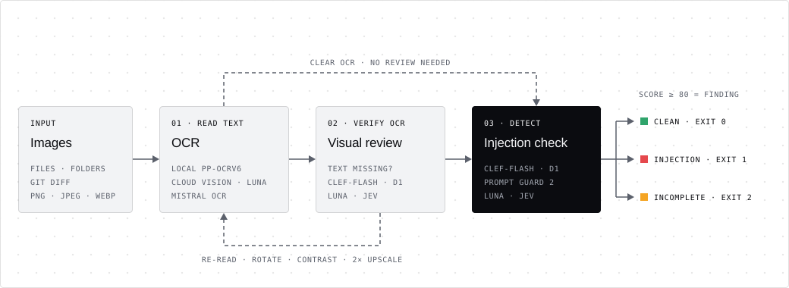

# Architecture

Accepted package boundaries are recorded in [ADR 0002](../adr-code/0002-product-and-research-boundaries.md).
The public scan contract is recorded in [ADR 0003](../adr-code/0003-public-cli-contract.md).
The current OCR profile and evaluation boundary are recorded in [ADR 0044](../adr-code/0044-product-research-recovery.md).
Research module ownership and dataset distribution are recorded in
[ADR 0012](../adr-code/0012-hugging-face-evaluation-dataset.md).

VIPI is one installable Python package, `vipi`, with the public commands
`vipi setup` and `vipi scan`. The repository also contains a separate research
environment, tests and dataset tools. Model weights, run artifacts, datasets and
the research web UI are not included in the wheel.

## Product boundaries

| Module | Owns |
| --- | --- |
| `vipi.cli` | Argument parsing, terminal interaction and process exit codes |
| `vipi.scanner` | A shared image scan and sequential scans of selected inputs |
| `vipi.inputs` | File discovery and immutable Git branch-diff inputs |
| `vipi.ocr` | Transformations, OCR engines, assembly and reusable model sessions |
| `vipi.detection` | Evidence, provider checks, score policies and saved-run replay |
| `vipi.results` | `OcrResult`, `DetectionResult` and `ScanResult` at component boundaries |
| `vipi.config` | Public defaults, validated `ScanOptions`, cache paths and credential resolution |
| `vipi.model_setup` | Explicit preparation of the release-pinned models |
| `vipi.reporting` | Conversion to the CLI report schema and its exit policy |
| `vipi.storage` | Atomic JSON, file hashes, run artifacts and transport-independent events |



The data flow is:

```text
CLI -> file/Git inputs -> scanner.scan_image
                           -> OCR -> OcrResult
                           -> detection -> DetectionResult
                           -> ScanResult -> report/exit code
```

`scan_image()` accepts image bytes or a path. It needs no existing OCR run,
dataset catalog or web application. Model sessions and providers can be reused
across an image selection. Scans continue to save input copies, transformed
images and reproducible detection artifacts; partial OCR failures retain their
artifact location in the report.

The detector's `detect(evidence, image=...)` path can operate in memory without
filesystem artifacts. `detect_ocr()` consumes an `OcrResult` directly, avoiding a
JSON write/read handoff. `detect_saved_run()` is the explicit adapter for loading
previous runs and replaying compatible provider answers. Both adapters share the
same detection and verdict implementation. Only final OCR text enters text
detectors; dataset references never become classifier evidence.

## OCR implementation

`vipi.ocr.types.OcrEngine.recognize(image)` returns text and regions in raster coordinates.
Transformation/assembly code uses this contract rather than a provider-specific
result. `OcrSession` owns the engine pool, model verification and artifact details.
Geometry matching lives in `vipi.ocr.merge_geometry`; `vipi.ocr.merge` selects
observed readings and assembles lines in page reading order. Assembly preserves
native line orientation and reads independent paragraph columns within horizontal
bands; simple aligned tables retain row order. Competing readings remain evidence,
and each result records its assembly version.
See [ADR 0020](../adr-code/0020-ocr-assembly-geometry-and-reading-order.md)
for the geometry rules and validation boundary.
`OCR_MODES`, `REQUIRED` and `model_files.json` map the public speed/quality modes
to checksum-pinned models. Setup and scan use that same description. A model
replacement changes this package/adapter, not input selection or detector code.

The selected recovery workflow lives in `vipi.ocr.recovery`:

| Module | Owns |
| --- | --- |
| `pipeline` | Engine lifetime, run state, completion and artifact persistence |
| `attempts`, `selection` | Transformed OCR attempts, recovery routing and candidate review |
| `decisions`, `decision_adapters` | Shared decision questions and local/hosted request adapters |
| `signals`, `extended_signals` | Local quality evidence and recovery routing |
| `layout`, `_layout_*` | Grouping in the readable image's coordinate frame |
| `probes`, `tiles` | Guarded resolution recovery and source-resolution tile retries |
| `resolution_retention`, `reading_edits` | Token retention and supported corrections |

`OcrSession` and research evaluation import this implementation directly.
Local engines and the factory stay in `engines`, hosted adapters in `cloud`,
and their existing recognition contract in `types`. Raster transforms,
multi-view assembly and per-run API cost estimates stay in `vipi.ocr`. The
workbench owns batch-level performance summaries in `reporting`.
`vipi.ocr.pipeline` supports the workbench's native baseline and fixed-transform
comparison profiles. `vipi.local_decisions` owns
the prepared Clef-Flash/d1 runtimes reused by OCR review and injection detection.

See [Product OCR recovery](ocr-recovery.md) for the recovery stages and measured
limits, [CLI usage](cli.md) for execution modes and model selection, and
[ADR 0045](../adr-code/0045-shared-ocr-recovery-ownership.md) for package ownership.

## Research boundary

`research/` imports `vipi`; `vipi` must not import `research` or Flask. Package
initializers and model metadata imports do not load inference frameworks.

- `research/catalog.py`: the one reader of the evaluation dataset in
  `research/dataset/` (ignored by Git, fetched by `research.download`).
- `research/workbench/`: local Flask UI. `scans` runs one product scan,
  `evaluations` runs `research.evaluate` in the background, `curation_routes` and
  `contribute_routes` serve the Dataset page; the browser code is `static/app.js` and
  `static/curation.js`.
- `research/evaluate/`: frozen split, evaluation runs of product scan
  configurations and the saved baseline.
- `research/ocr_eval/`: OCR metrics, the dataset benchmark and its report.
  Retained trial operators live in `experiments/`, with historical findings
  under `reports/`.
- `research/curation/`: dataset validation, labeling store and image
  generators.

OCR and detector stores keep their distinct states. Shared atomic writes, hashes
and event iteration are consolidated.
Persisted JSON schemas and run directory layouts are shared across the product
and research tools. The evaluation dataset (`catalog.json`, `vocabulary.json`,
`images/`) lives in `research/dataset/`, downloaded from the Hugging Face
dataset at the commit pinned in `research/dataset.json`; GitHub tracks the
evaluation code ([ADR 0053](../adr-code/0053-one-evaluation-dataset.md)).

## Dependencies and tests

`ocr` and `ocr-cuda` select alternative OCR runtimes. `detector-local` supplies
Prompt Guard and its model-download client. `research` supplies Flask for the
local workbench; `test` supplies pytest and Ruff. The published CLI does not
install Flask by selecting `ocr`.

Tests are grouped into `tests/unit`, `tests/integration` and `tests/research`.
Boundary tests prevent imports from the product into research/web frameworks and
verify direct detection without reading a saved OCR run. The wheel includes only
`src/vipi`; source distributions include the product tests and their fixtures.
