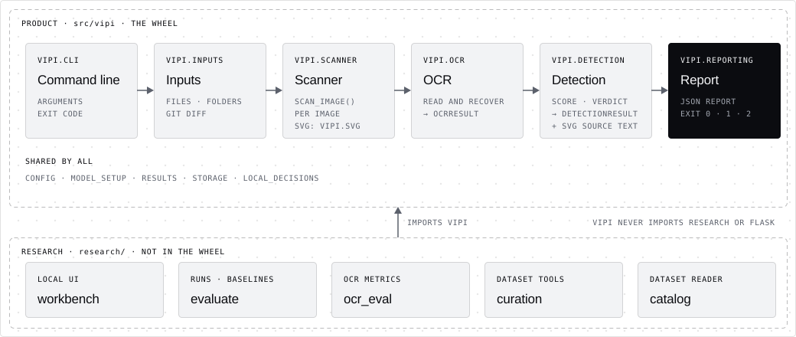
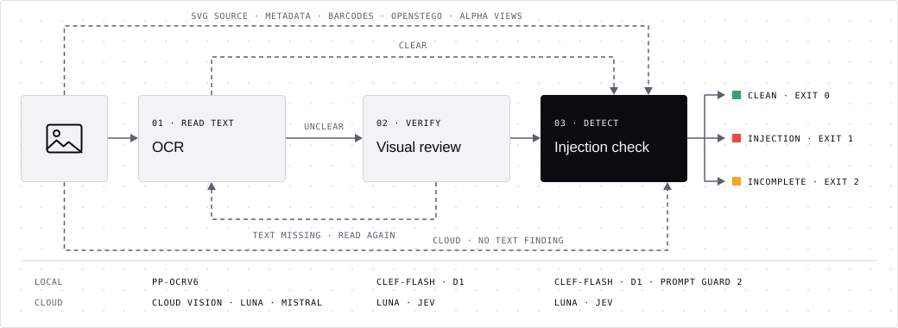

# Architecture

Accepted package boundaries and removal of retired scan paths are recorded in
[ADR 0067](../adr-code/0067-remove-retired-scan-paths.md).
The public scan contract is recorded in [ADR 0003](../adr-code/0003-public-cli-contract.md).
The current OCR profile and evaluation boundary are recorded in [ADR 0044](../adr-code/0044-product-research-recovery.md).
Research module ownership and dataset distribution are recorded in
[ADR 0012](../adr-code/0012-hugging-face-evaluation-dataset.md).

VIPI is one installable Python package, `vipi`, with the public commands
`vipi setup` and `vipi scan`. The repository also contains a separate research
environment, tests and dataset tools. Model weights, run artifacts, datasets and
the research web UI are not included in the wheel.

## Product boundaries



| Module | Owns |
| --- | --- |
| `vipi.cli` | Argument parsing, terminal interaction and process exit codes |
| `vipi.scanner` | A shared image scan and sequential scans of selected inputs |
| `vipi.inputs` | File discovery and immutable Git branch-diff inputs |
| `vipi.images` | Raster decoding and preparation for hosted image decisions |
| `vipi.transparency` | White, black and raw-colour views of images with transparent pixels ([ADR 0085](../adr-code/0085-transparency-views.md)) |
| `vipi.svg` | SVG source text, the render-safe copy and resvg rendering ([ADR 0078](../adr-code/0078-svg-inputs.md)) |
| `vipi.openstego` | Legacy OpenStego and RandomLSB headers and payload text in original PNG samples ([ADR 0088](../adr-code/0088-legacy-openstego-reading.md), [ADR 0089](../adr-code/0089-openstego-random-lsb-reading.md)) |
| `vipi.png_lsb` | Text candidates in declared PNG layouts and optional original sample-pair statistics ([ADR 0090](../adr-code/0090-declared-png-lsb-layouts.md), [ADR 0091](../adr-code/0091-png-lsb-statistics.md)) |
| `vipi.ocr` | Transformations, OCR engines, assembly and reusable model sessions |
| `vipi.detection` | Text and whole-image checks, one selected detector and score policy |
| `vipi.results` | `OcrResult`, `DetectionResult` and `ScanResult` at component boundaries |
| `vipi.config` | Public defaults, validated `ScanOptions`, cache paths and credential resolution |
| `vipi.model_setup` | Explicit preparation of the release-pinned models |
| `vipi.reporting` | Conversion to the CLI report schema and its exit policy |
| `vipi.storage` | Atomic JSON, file hashes, run artifacts and transport-independent events |



The data flow is:

```text
CLI -> file/Git inputs -> scanner.scan_image
                           -> (SVG: vipi.svg source text + rendered PNG)
                           -> OCR -> OcrResult
                              (transparent raster: OCR per distinct view)
                           -> detection (+ other text readings and cloud image checks)
                           -> DetectionResult
                           -> ScanResult -> report/exit code
```

`scan_image()` accepts image bytes or a path. It needs no existing OCR run,
dataset catalog or web application. Model sessions and providers can be reused
across an image selection. Scans continue to save input copies, transformed
images and reproducible detection artifacts; partial OCR failures retain their
artifact location in the report.

The detector's `detect(evidence)` path operates in memory without filesystem
artifacts. `detect_ocr()` consumes an `OcrResult` directly and persists its checks
beside the OCR artifacts. The selected detector checks final OCR text and either
the SVG source reading or, for raster images, the metadata reading
(`vipi.image_metadata`, [ADR 0083](../adr-code/0083-image-metadata-reading.md)),
plus the decoded QR and barcode payloads (`vipi.barcodes`,
[ADR 0084](../adr-code/0084-barcode-reading.md)), text from supported OpenStego
PNGs (`vipi.openstego`, [ADR 0088](../adr-code/0088-legacy-openstego-reading.md),
[ADR 0089](../adr-code/0089-openstego-random-lsb-reading.md)),
text candidates from caller-declared PNG LSB layouts ([ADR 0090](../adr-code/0090-declared-png-lsb-layouts.md)),
and the final OCR text of an image's black and raw-colour views where applicable
(`vipi.transparency`, [ADR 0085](../adr-code/0085-transparency-views.md)). In a regular cloud scan it checks the same input raster
(each distinct view of a transparent image) after a text verdict with no finding, with the same detection policy and verdict
threshold ([ADR 0082](../adr-code/0082-cloud-image-check-without-image-only-scans.md)). Dataset references
remain scoring inputs. Evaluation reuse of complete
OCR/detection results belongs to `research.ocr_eval.ocr_reuse`.
Requested PNG low-bit statistics are carried to the report without adding
detector evidence ([ADR 0091](../adr-code/0091-png-lsb-statistics.md)).

## OCR implementation

`vipi.ocr.types.OcrEngine.recognize(image)` returns text and regions in raster coordinates.
Transformation/assembly code uses this contract rather than a provider-specific
result. `OcrSession` owns the engine pool, model verification and artifact details.
Geometry matching lives in `vipi.ocr.merge_geometry`; `vipi.ocr.merge` selects
observed readings and assembles lines in page reading order. Assembly preserves
native line orientation and reads independent paragraph columns within horizontal
bands; simple aligned tables retain row order. Competing readings remain evidence,
and each result records its assembly version.
See [ADR 0020](../adr-code/0020-ocr-assembly-geometry-and-reading-order.md)
for the geometry rules and validation boundary.
`OCR_MODES`, `REQUIRED` and `model_files.json` map the public speed/quality modes
to checksum-pinned models. Setup and scan use that same description. A model
replacement changes this package/adapter, not input selection or detector code.

The selected recovery workflow lives in `vipi.ocr.recovery`:

| Module | Owns |
| --- | --- |
| `pipeline` | Engine lifetime, run state, completion and artifact persistence |
| `attempts`, `selection` | Transformed OCR attempts, recovery routing and candidate review |
| `decisions`, `decision_adapters` | Shared decision questions and local/hosted request adapters |
| `signals`, `extended_signals` | Local quality evidence and recovery routing |
| `layout`, `_layout_*` | Grouping in the readable image's coordinate frame |
| `probes`, `tiles` | Guarded resolution recovery and source-resolution tile retries |
| `resolution_retention`, `reading_edits` | Token retention and supported corrections |

`OcrSession` and research evaluation import this implementation directly.
Local engines and the factory stay in `engines`, hosted adapters in `cloud`,
and their existing recognition contract in `types`. Raster transforms,
multi-view assembly and per-run API cost estimates stay in `vipi.ocr`.
`research.ocr_eval.benchmark_report` owns dataset scoring and aggregate reports;
`research.evaluate` owns baseline comparisons. `vipi.local_decisions` owns
the prepared Clef-Flash/d1 runtimes reused by OCR review and injection detection.

See [Product OCR recovery](ocr-recovery.md) for the recovery stages and measured
limits, [CLI usage](cli.md) for execution modes and model selection, and
[ADR 0067](../adr-code/0067-remove-retired-scan-paths.md) for package ownership.

## Research boundary

`research/` imports `vipi`; `vipi` must not import `research` or Flask. Package
initializers and model metadata imports do not load inference frameworks.

- `research/catalog.py`: the one reader of the evaluation dataset in
  `research/dataset/` (ignored by Git, fetched by `research.download`).
- `research/workbench/`: local Flask UI. `scans` runs one product scan,
  `evaluations` runs `research.evaluate` in the background, `curation_routes` and
  `contribute_routes` serve the Dataset page; the browser code is `static/app.js` and
  `static/curation.js`.
- `research/evaluate/`: frozen split, evaluation runs of product scan
  configurations and the saved baseline.
- `research/ocr_eval/`: OCR metrics, the dataset benchmark and its report.
  Retained trial operators live in `experiments/`, with historical findings
  under `reports/`.
- `research/curation/`: dataset validation, labeling store and image
  generators.

OCR and detector stores keep their distinct states and emit progress through
callbacks while persisting events. Atomic JSON writes and hashes are shared;
the workbench polls its scan/evaluation services.
Persisted JSON schemas and run directory layouts are shared across the product
and research tools. The evaluation dataset (`catalog.json`, `vocabulary.json`,
`images/`) lives in `research/dataset/`, downloaded from the Hugging Face
dataset at the commit pinned in `research/dataset.json`; GitHub tracks the
evaluation code ([ADR 0053](../adr-code/0053-one-evaluation-dataset.md)).

## Dependencies and tests

`ocr` and `ocr-cuda` select alternative ONNX OCR runtimes and shared image,
layout and quality-signal dependencies. `detector-local` supplies PyTorch,
Transformers, the local decision models and Wolf Defender's runtime dependencies.
`research` supplies Flask for the local workbench; `test` supplies pytest and
Ruff. Cloud installation with `ocr` requires neither PyTorch nor TensorFlow.

The retired fixed-transform pipeline, detector image/context/comparison modes,
saved-run detector replay and old per-view evaluation aggregators are removed.
Retained experiment operators remain under `research/ocr_eval/experiments/`.

Tests are grouped into `tests/unit`, `tests/integration` and `tests/research`.
Boundary tests prevent imports from the product into research/web frameworks and
verify direct detection without reading a saved OCR run. The wheel includes only
`src/vipi`; source distributions include the product tests and their fixtures.
