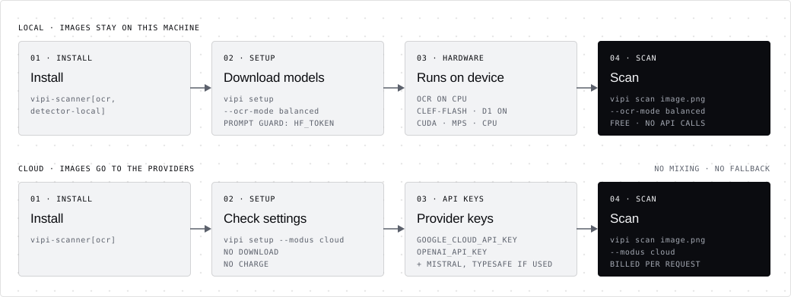

# VIPI CLI

The public commands are `vipi setup` and `vipi scan` (`python -m vipi`
provides the same interface). Use Python 3.12 and uv.
For installation, see the [README](../README.md#quick-start); for the exact
model-to-purpose mapping, see [models and hardware](models.md). From a checkout:

```bash
uv sync --extra ocr --extra detector-local
uv run vipi setup --ocr-mode balanced
uv run vipi scan image.png --ocr-mode balanced --output report.json
```



## Commands and options

`vipi setup` explicitly prepares pinned OCR weights and the selected local
decision/detector models. Without an OCR mode/model, it prepares all three local
OCR sizes and the default Clef-Flash decision model. `--ocr-mode` prepares one local
profile. Cloud setup downloads no weights and makes no billable request;
credentials are checked when scanning. Scanning never downloads models.

`vipi scan PATH [PATH ...]` scans static PNG/JPEG/WebP files and directories
recursively. With `--diff` and no paths, it scans the current directory's scope.
Without `--diff`, at least one path is required.

| Shared setup/scan option | Meaning and default |
| --- | --- |
| `--modus local|cloud` | Full execution mode. Default local; a direct cloud `--ocr-model` also infers cloud for compatibility. |
| `--ocr-mode speed|balanced|quality|fast` | Local profile; `quality` is the scan default and `fast` aliases `speed`. Setup without this option prepares all OCR sizes. |
| `--ocr-model ID` | Override OCR with `ppocr-v6`, `ppocr-v6-medium`, `ppocr-v6-small`, `ppocr-v6-tiny`, `google-cloud-vision`, `gpt-6-luna` or `mistral-ocr-4-1`. |
| `--ocr-provider google|openai|mistral` | Cloud OCR selection, default Google. Requires explicit `--modus cloud`; cannot be combined with `--ocr-model`. |
| `--decision-provider clef-flash|d1|jev|openai` | OCR review model. Default local quality: Clef-Flash; other local profiles: d1; cloud: OpenAI Decisions. |
| `--detector auto|jev|openai|prompt-guard|clef-flash|d1` | Final text detector. Default `auto` follows the decision provider. |
| `-h`, `--help` | Show root or command help and exit without preparing models. |

| Scan-only option | Meaning and default |
| --- | --- |
| `--diff REFERENCE` | Select committed images added/modified since the common ancestor of REFERENCE and HEAD. |
| `--exclude PATTERN` | Repeatable ordered filesystem exclusion; `!` re-includes matching paths. No user rules by default. |
| `--threshold 0–100` | Finding threshold, default 80. Equality is a finding. |
| `--output FILE` | Also write an atomic JSON report, including findings or incomplete scans. |
| `--verbose` | Print each image's final OCR text. Off by default. |
| `--list-only` | Run input selection only and list the selected images; no models, providers or keys are used. Selected files have status `selected` and the report status is `listed`; exit 2 on selection errors, otherwise 0. |

Local/cloud choices must agree. Explicit cloud mode rejects `--ocr-mode`, and
local/cloud detector or decision providers cannot be mixed. A local explicit
OCR model does not change the profile's decision model. There is no provider
fallback. The final detector receives the selected OCR text, never dataset
references or individual transformation variants. See
[recovery stages](ocr-recovery.md) for spatial retries and retained evidence.

```bash
uv run vipi scan label.png screenshot.jpg
uv run vipi scan ./images --verbose
uv run vipi scan ./images --ocr-mode speed
uv run vipi scan image.png --modus cloud --ocr-provider mistral --decision-provider jev
uv run vipi setup --ocr-mode balanced --detector prompt-guard
uv run vipi scan ./images --ocr-mode balanced --detector prompt-guard
```

## Credentials and local models

Environment variables take precedence over `.env` in the current directory.
All aliases are checked in the environment first; an explicitly empty provider
setting prevents fallback to the file. See [`.env.example`](../.env.example).

| Provider | Credential |
| --- | --- |
| Google OCR | `GOOGLE_CLOUD_API_KEY`, alias `GOOGLE_API_KEY` |
| OpenAI OCR/review/detection | `OPENAI_API_KEY` |
| Mistral OCR | `MISTRAL_API_KEY` |
| Jev review/detection | `TYPESAFE_API_KEY`, alias `JEV_API_KEY` |
| Clef-Flash/d1 | Prepared local weights and verified code; no inference API key |
| Prompt Guard | Prepared local weights; authorized Hugging Face access (`HF_TOKEN` or existing login) for downloads |

The `ocr` extra supplies local OCR and shared image operations. Local decision
models and Prompt Guard additionally need `detector-local`. Local PP-OCRv6 runs
through ONNX on CPU in the public scanner; decision models select available
CUDA, Apple MPS or CPU. Research scan configurations use the same OCR execution
path as the public scanner.
Cloud recovery can submit additional transformed images and make billable OCR
and decision requests. Reports retain actual usage and unknown costs as unknown.

## Excluding images

Copy [`.vipiignore.example`](../.vipiignore.example) to `.vipiignore`. VIPI reads
it from the Git repository root, or the scanned directory/explicit file's parent
outside Git. `--exclude` rules follow file rules; the last matching rule wins.

```text
generated/
*.webp
!generated/reviewed.webp
```

Patterns use forward-slash paths relative to the rule root. Names without `/`
match a component at any depth; paths with `/` are rooted. A leading `/` anchors
a pattern, a trailing `/` includes directory contents, and `**` spans directories.
Blank lines and `#` comments are ignored. Ordered `!` rules re-include images
within the requested scope, but cannot override built-in exclusions. To select
only PNG files, use `*` followed by `!*.png`.

This is a supported subset, not full `.gitignore` syntax. Excluded paths and
their rules appear as skipped, not safe. To check rules without scanning, add
`--list-only`.

Diff scans read `.vipiignore` from the repository root of the `--diff`
reference, not from the worktree or the compared branch, so a branch cannot
exempt its own images; a rule change applies once it is on the base branch.
`--exclude` rules follow as usual. Each changed image is matched by its
committed path, and excluded images are listed individually
([ADR 0072](../adr-code/0072-exclusions-in-git-diff-scans.md)).

## Branch and PR scans

```bash
uv run vipi scan . --diff origin/main --output report.json
```

Selection compares the common ancestor with HEAD against HEAD, then reads full
committed image bytes from Git objects. Uncommitted edits and untracked files
do not affect it. Paths restrict the selection. Deleted images are skipped;
renames are deletion plus addition. Image symlinks are errors. Missing refs or
insufficient history are errors; fetch the target and enough history first.

## GitHub Action

The Action lives in [EnXan/vipi-action](https://github.com/EnXan/vipi-action),
which documents its inputs, outputs and versions; see the
[workflow example](../README.md#github-actions). It installs a pinned
`vipi-scanner` release from PyPI, runs `vipi scan --list-only` and prepares
models only when images are selected; models are downloaded each run and not
cached ([ADR 0070](../adr-code/0070-action-setup-only-for-selected-images.md),
[ADR 0073](../adr-code/0073-github-action-in-its-own-repository.md)).

PR events scan images added or modified at the PR commit relative to the
actual base branch, with `paths` restricting scope; use checkout
`fetch-depth: 0`. PR scans take `.vipiignore` from the base branch; the
`exclude` input comes from the workflow file, which `pull_request` events read
from the PR. A detection returns 1 and an incomplete scan returns 2; upload
reports with `if: always()` to retain either.

## Limitations

- **Inputs:** static PNG, JPEG and WebP only; extensions are matched
  case-insensitively and animated images are rejected. Local scans accept up to
  40 megapixels; cloud scans follow the provider's limits.
- **Other files:** unsupported files in scanned folders or diffs are skipped and
  listed in the report; an unsupported file named explicitly is an error.
- **Scores:** thresholds are operating points and `injection_probability` is not a
  calibrated attack probability. `no_injection_detected` means the detector
  stayed below the threshold on the final OCR text; it does not prove the image
  is safe, and it does not say whether OCR missed readable text.
- **Cost:** cloud scans can make additional billable requests when OCR is
  unclear and the image is reviewed or read again.

## Results and storage

| Exit code | Meaning |
| --- | --- |
| `0` | All selected images completed without `injection_detected`, including an empty selection and images without text |
| `1` | At least one `injection_detected` and all images completed |
| `2` | Invalid settings, missing runtime/models/keys, detector or provider failure, refusal, missing threshold, unreadable input or interruption |

Errors take precedence. Each file record has a `verdict`: `injection_detected`,
`no_injection_detected`, or `null` when a required detector check did not
complete (the file is then an error). `injection_probability` is the highest
native detector probability over all completed checks and text chunks, reported
next to the `threshold` that decides the verdict; it is `null` when the final
OCR text is empty. An image without text calls no detector and is
`no_injection_detected`. Long text is checked in chunks: any chunk at or above
the threshold detects, all chunks below it do not. The report `schema_version`
is 2.

`ocr_incomplete` says whether readable image text is missing from the final OCR
text: `true`, `false`, or `null` when it was not judged. When recovery kept the
first reading, the visual review's existing completeness answer is reused
(`missing_text` is `true`; `complete` with sufficient detail is `false`;
anything else `null`). When recovery changed the final text, the same question
is asked once more about the final text, which adds one visual-review call.
Clear OCR needs no review, so the value is `null` and no call is added. If that
extra call fails, the value is `null` and the reason is kept in the run's
`selection.ocr_incomplete_error`. The summary counts `ocr_incomplete: true`
files; exit codes ignore the flag.
Explicit unsupported files are errors. Directory scans record unsupported files
as skipped and exclude `.git`, `.venv*`, `node_modules`, `__pycache__`, directory
symlinks and VIPI's cache. Image symlinks are errors.

Reports include resolved models, hashes, runtime identities, threshold, timing,
usage/cost evidence, artifact paths, skipped/error/not-scanned inputs and diff
commit IDs. `--output` cannot overwrite a selected image. Terminal output uses
a live progress display when supported; redirected output uses a compact brand.

| Platform | Default cache |
| --- | --- |
| macOS | `~/Library/Caches/vipi/` |
| Linux | `~/.cache/vipi/` |
| Windows | `%LOCALAPPDATA%/vipi/` |

`XDG_CACHE_HOME/vipi/` overrides these defaults. OCR files live in `ocr/`, local
decision models in `decisions/clef-flash` and `decisions/d1`, Prompt Guard in
`prompt-guard/`, and persistent input/variant/result artifacts in `runs/`.

## Platform validation status

Earlier CLI versions were tested on macOS, Linux and Windows on 2026-10-24.
That does not validate the current trained recovery models on every platform.
Current unit/integration/research checks and package smoke tests use fixtures;
CI runs on Ubuntu. The recorded trained Tiny+d1 run was on Apple MPS; see
[the recovery measurement boundary](ocr-recovery.md#measurement-and-costs).
Fresh Clef-Flash quality on CUDA or CPU, cloud-provider and Windows/Linux inference require separate
validation. A platform claim should record a fresh install, model setup, image
and Git-diff scan, JSON output, exit codes and the actual model/provider.
