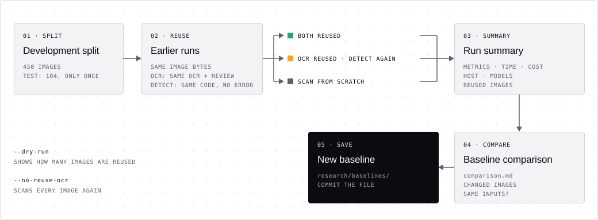

# Evaluation

Evaluate one product scan configuration on a frozen split of the dataset and
compare it with the saved baseline, from this command line or the workbench
**Evaluate** page. The workflow for changes is in
[CONTRIBUTING.md](../../CONTRIBUTING.md#evaluating-improvements); the design is
recorded in [ADR 0054](../../adr-code/0054-evaluation-runs-and-baseline.md).

## Configurations

A configuration is a set of `vipi scan` options. The threshold stays at the
product default (80); the detector stays `auto` unless the name ends in `-jev`.

| Configuration | Scan options | Detector |
| --- | --- | --- |
| `local-speed`, `local-balanced` | `--modus local --ocr-mode <mode>` | d1 |
| `local-quality-clef-flash` | `--modus local --ocr-mode quality --decision-provider clef-flash` (the product default since ADR 0065) | Clef-Flash (also reviews OCR) |
| `local-speed-prompt-guard`, `local-balanced-prompt-guard`, `local-quality-prompt-guard` | the local configuration plus `--detector prompt-guard` | Prompt Guard 2 (OCR review stays d1 or Clef-Flash) |
| `cloud-google`, `cloud-openai`, `cloud-mistral` | `--modus cloud --ocr-provider <provider>` | OpenAI Luna |
| `cloud-google-jev`, `cloud-openai-jev`, `cloud-mistral-jev` | the same plus `--detector jev` | Jev |

A `-jev` configuration and its counterpart without the suffix share OCR and
OCR review; only the final detector differs, so comparing their runs compares
the two detectors on the same text. Each has its own baseline. Jev needs
`TYPESAFE_API_KEY`; its usage is recorded, but no cost is estimated. The same
holds for a `-prompt-guard` configuration and its local counterpart; Prompt
Guard 2 needs accepted model terms on Hugging Face for `vipi setup --detector
prompt-guard` and then runs offline.

Local configurations run offline (network blocked) and need the models from
`vipi setup`. Cloud configurations need the provider API keys and incur
charges for OCR, decisions and detection.

## Splits

[`../splits.json`](../splits.json) assigns all 554 dataset entries to two
disjoint splits: 450 `development` and 104 `test`. Entries sharing content
stay together: byte-identical images, the same source `content_group_id`, the
same visible text, texts sharing at least 80% of their words (template
variants that differ in a slot word), the same scenario family of former
detection fixtures (filename stem without obfuscation suffixes such as
`_low-contrast` or `_none`) and listed matched benign controls
(`CONTROL_GROUPS` in `splits.py`). Groups are ranked by seeded SHA-256 per
label × content stratum and the test split is filled up to 20% of each
stratum.

- Use `development` for every evaluation.
- Use `test` only once, to confirm a change before a default changes. Do not
  iterate or tune on it.

Regenerate after the pinned dataset revision changes, and verify that the
committed file still matches the downloaded dataset:

```bash
uv run python -m research.evaluate split
uv run python -m research.evaluate split --check
```

Regenerating may move entries between splits. Test entries that were already
used for development work would then no longer be unseen; review the diff
before committing a regenerated split.

## Run, compare, save



```bash
uv run python -m research.evaluate status local-speed
uv run python -m research.evaluate run local-speed --dry-run
uv run python -m research.evaluate run local-speed
uv run python -m research.evaluate save-baseline <run-id>
uv run python -m research.evaluate rescore <run-id>
```

- `status` reports whether the latest saved baseline of the configuration
  still matches this checkout: `fresh`, `stale` with the changed fields, or
  `none`. It exits non-zero unless fresh. Identity covers the dataset revision,
  catalog, split file, selected entries with image/reference hashes, metric
  sources, scan options and declared model identity (the `*_MODEL` constants
  and only the registry entries the configuration loads, ADR 0060); product source code is
  excluded because a change differs from its baseline by design.
- `run` scans every entry of the split with the configuration (OCR and
  detection) and writes `runs/evaluations/<run-id>/` (ignored by Git):
  benchmark outputs, `report.json`/`report.md`, `summary.json` and
  `operations.json`. It records the commit, whether the working tree was dirty
  and hashes of uncommitted/untracked changes. Resume an interrupted run with
  `--run-id <id>`; completed and failed attempts are kept. The test split
  requires `--confirm-test-split`.
- By default `run` reuses results of completed runs in the runs folder for a
  byte-identical image. The OCR is reused when OCR model, OCR mode, review
  model, OCR-related product sources and runtime packages are the same; the
  detection is reused as well when, in addition, the detector, detection
  settings, every product source and every package version are the same and
  the earlier detection completed without errors (ADR 0064). Otherwise the
  missing part runs. A `cloud-google-jev` run after a
  `cloud-google` run therefore pays only for Jev, and repeating a run on
  unchanged code reuses everything. Reused rows keep the original time and cost
  (so totals compare with full runs); the report states how many images were
  reused, with or without detection, and the cost not spent again.
  `--dry-run` prints both counts; `--no-reuse-ocr` scans everything. A resumed
  run keeps its choice. Details: [ADR 0058](../../adr-code/0058-reuse-ocr-across-runs.md).
- If a baseline of the same configuration and split is saved, `run` compares
  with it and writes `comparison.md`/`.json` into the run directory. Runs with
  different inputs are labeled "not the same inputs" with the changed fields.
- `save-baseline` copies a complete run's summary to
  `research/baselines/<run-id>.json`. Commit that file. Save the baseline on
  unmodified code, before changing anything.
- `rescore` scores a complete run again with the current scoring code, without
  scanning, after a change to `research/ocr_eval/evaluation/` or
  `benchmark_report.py` has made its baseline stale. It rewrites the run's
  report and replaces only the metrics and the scoring-code and report hashes
  in the run summary and in its saved baseline; commit the updated baseline.
  It needs the run's retained outputs, so run it on the computer that ran the
  evaluation ([ADR 0068](../../adr-code/0068-position-free-benchmark-scoring.md)).

## Metrics

- **OCR** (entries with reference text): tolerant and exact word coverage,
  image pass rates, failures; see the [OCR evaluation guide](../ocr_eval/README.md).
  References without a reading order are scored without word positions, so
  every OCR provider is scored on every image ([ADR 0068](../../adr-code/0068-position-free-benchmark-scoring.md)).
- **Detection** (all entries): benign entries must be `not_flagged`, injection
  and jailbreak entries `flagged`. Reported: attacks flagged (recall), benign
  flagged (false-positive rate), accuracy, unclear verdicts and scans without
  result. Every entry is in the denominator. Caller-context cases are not run.
- **Cost and resources**: per-image time, estimated API cost, run wall time,
  CPU time and peak memory from `psutil` sampling every 0.5 s. CPU time is a
  lower bound because short-lived workers can exit between samples. GPU/MPS
  memory is allocated inside worker processes and is recorded as unavailable.
- **Execution**: the host (CPU, cores, RAM, GPU) and the device and dtype of
  OCR, OCR review and injection detector, or `api` for hosted providers
  ([ADR 0062](../../adr-code/0062-record-execution-devices.md)). Shown in the
  report and the workbench; older baselines show only their host.

The comparison lists every entry whose scan newly failed or recovered, whose
OCR coverage regressed or improved, and whose verdict became wrong or right,
plus the files changed between the two runs' commits. It does not decide
whether a change is accepted. Without the baseline's local report (a baseline
saved on another machine) it compares aggregates only.
